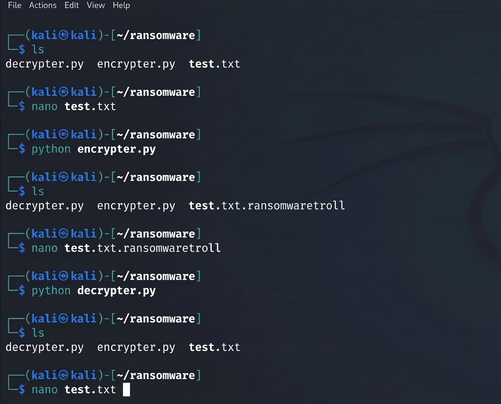

# Understanding Ransomware in Practice with Python

Project developed during the **Santander Cybersecurity Bootcamp**, under the guidance of expert **[Cassiano Peres](https://github.com/cassianobrexbit/ "Cassiano Peres")**.

The objective of this project challenge is to implement a basic educational ransomware concept using the Python programming language for study purposes and defensive security awareness.

## Project Structure

- ``encrypter.py``: Script responsible for reading a text file, encrypting it using the AES algorithm (CTR mode), and updating its file extension.
- ``decrypter.py``: Script responsible for reversing the process by decrypting the file and restoring its original content.
- ``test.txt``: Sample text file used to demonstrate the encryption and decryption workflow.

## Technologies and Libraries

- **Python 3**
- ``pyaes`` library (pure Python implementation of the AES encryption algorithm).
- Native ``os`` library (for file system interaction and removal).

## How to Run

Ensure you have Python installed along with the ``pyaes`` package configured in your environment (such as Kali Linux).

- Install the required dependency:

 ```bash
 pip install pyaes
 ```

- Create a test file (``test.txt``) with sample content:

 ```bash
 echo "This is an educational ransomware demonstration." > test.txt
 ```

- Run the encryption script:

 ```bash
 python encrypter.py
 ```

 (The file ``test.txt`` will be encrypted and renamed to ``test.txt.ransomwaretroll``)

- Run the decryption script to restore the original file:

 ```bash
 python decrypter.py
 ```



## Disclaimer

*This project was developed strictly for educational and cybersecurity awareness purposes. Using encryption techniques maliciously on unauthorized systems is illegal.*

[LICENSE](/LICENSE)
