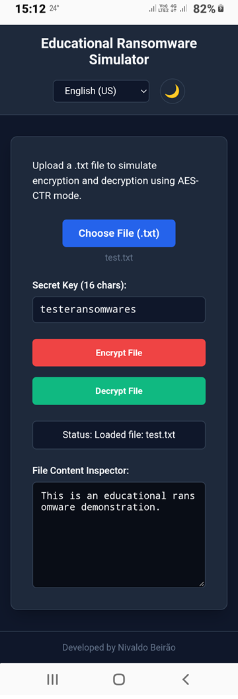
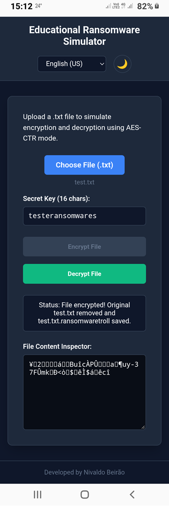
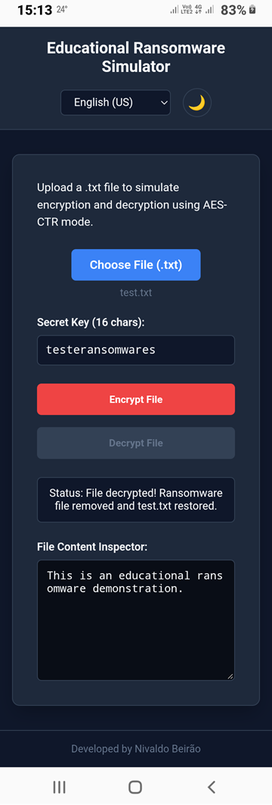

# Understanding Ransomware in Practice with Python and Web UI

Project developed during the **Santander Cybersecurity Bootcamp**, under the guidance of expert **[Cassiano Peres](https://github.com/cassianobrexbit/ "Cassiano Peres")**.

This project provides both a command-line interface (**Python**) and an interactive web interface (**HTML5, CSS3, JavaScript**) to demonstrate educational ransomware encryption/decryption mechanisms safely.

## Tecnologies used

- **HTML5**: Complete single-file web application built with responsive design, accessibility standards (a11y), Dark/Light theme switching, and multi-language support (EN-US, PT-BR, ES).
- **CSS3**: Modern styling utilizing CSS custom properties (variables) for dynamic theming, Flexbox/Grid for responsive layouts across desktops, tablets, and smartphones, and custom UI components.
- **JavaScript**: Client-side logic handling file reading/writing via the FileReader API, AES-CTR encryption and decryption routines using CryptoJS, dynamic language translation dictionaries, and state management for UI elements.

## Features (Web Interface)

- **AES CTR Mode Encryption:** Simulates file encryption using CryptoJS in the browser.
- **File Upload & Inspector:** Supports drag-and-drop or manual upload of `.txt` and `.ransomwaretroll` files.
- **Multilingual Support:** Dynamic language switching for English (EN-US - Primary), Portuguese (PT-BR), and Spanish (ES).
- **Theme Switching:** Dark theme active by default with toggle control for Light theme.
- **Responsive & Accessible Design:** Built using semantic HTML5 elements, appropriate contrast ratios, and screen-reader accessible controls.

## How to Run

### Web Interface

1. Open `index.html` in any modern web browser (Desktop, Tablet, or Smartphone).
2. Upload or drag & drop a `.txt` file into the designated upload drop zone.
3. Click **Encrypt File** to encrypt the content and automatically download `test.txt.ransomwaretroll`.
4. Upload the encrypted file back to the browser and click **Decrypt File** to restore `test.txt`.

Loaded file

Encrypted file

Decryptedfile

## Disclaimer

*This repository is intended strictly for educational and cybersecurity research purposes. Utilizing encryption routines maliciously or without explicit authorization on target machines is strictly prohibited and illegal.*

[LICENSE](./LICENSE)
